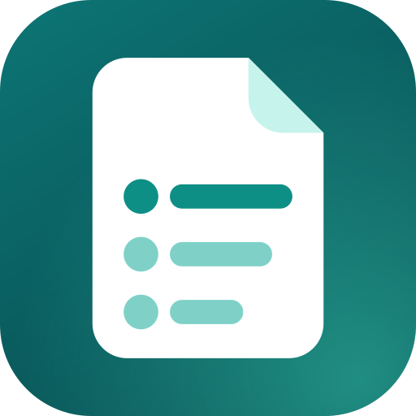

<p align="center">
  
</p>

<h1 align="center">List</h1>

<p align="center">
  <b>An offline file viewer for Android.</b><br>
  Documents, spreadsheets, presentations, PDFs, books, archives, pictures, audio and video open right inside the app.<br>
  No cloud, no account, no ads.
</p>

<p align="center">
  <a href="../../releases/latest/download/List.apk"><b>Download the APK</b></a>
  &nbsp;·&nbsp; Android 7.0 or newer
  &nbsp;·&nbsp; <b>English</b> | <a href="README.ru.md">Русский</a>
</p>

---

## Features

- **One app for most files.** PDF, Word, Excel, PowerPoint, OpenDocument, RTF, EPUB, FB2, HTML, Markdown, JSON, plain text and code, ZIP/RAR/7z/TAR archives, pictures, audio and video.
- **Works offline and keeps files private.** Everything is rendered on the device and nothing is uploaded.
- **Recent files that are easy to navigate.** Grouped by day, searchable by name, filterable by file type, and sortable by date, name, size or type. Pin the files you need most to the top. Removing an entry can be undone, and files that were moved or deleted are marked instead of failing silently.
- **Pick up where you left off.** List remembers the page of a PDF, the place in a document, and the moment in a song or video, and returns you there the next time you open the file.
- **Your own order.** Give a file a clearer name (its extension stays locked) and sort files into colored folders. Names and folders live inside List, so the files on your phone are never touched. To give a file the new name on the phone itself, use **Save a copy…**.
- **Several files at once.** Long-press a file to select it, then pin, move, share or remove everything selected in one go.
- **Reading tools.** Search inside documents and PDFs (in a PDF it lists the pages that have the words, shows the text around the match and marks the words on the page), pinch and double-tap zoom, a page counter for PDFs, a *Pages / Reading view* switch for Word files, a *Slides / Text* switch for presentations, sheet tabs for workbooks, and a browsable list of the files inside an archive. Reading options set the text size and can show PDF pages dark in the dark theme.
- **A proper screen for audio.** Music and recordings open on their own screen instead of a black video surface: the cover and tags stored in the file, a seek bar, 10-second jumps and a speed button. The audio files of the list play one after another, with buttons for the previous and the next track. Music goes on with the screen off and in front of other apps, with the controls in the notification and on the lock screen (this can be switched off in the options of the audio screen). Playback pauses for a phone call or when the headphones are pulled out. Video keeps the usual player controls.
- **Next and previous file.** A file that was opened from the list has arrows in the top bar and shows its place in the list ("3 / 12"), so a folder of documents or pictures can be read through without going back.
- **Easy bug reports.** **About** copies the version, the kind of build, the Android version, the device and the key that signed the app. After a crash List offers to copy a report with the error (file paths are removed from it).
- **Your list is safe.** **Back up the list** saves the names, folders and reading places to a small file; **Restore from a backup** brings them back after a reinstall or on a new phone. If Android loses access to a file, **Locate file…** points the entry at it again without losing its name, folder or place.
- **Plays well with other apps.** Choose *List* from "Open with" in a file manager or messenger, or share files to it from the system *Share* menu. *Back* returns to the app the file came from. Any file can be shared or opened in another app from the ⋮ menu.
- **Looks at home on your phone.** Light and dark themes follow the system, and the interface is available in English and Russian (it follows the system language).

## Supported formats

| Kind | Extensions | How it is shown |
|---|---|---|
| PDF | `pdf` | Android's built-in `PdfRenderer` for the pages, [PdfBox-Android](https://github.com/TomRoush/PdfBox-Android) to read their text for the search |
| Word | `docx` `docm` `dotx` `dotm`, and `doc` `dot` `odt` `rtf` | [docx-preview](https://github.com/VolodymyrBaydalka/docxjs) for page layout and [mammoth](https://github.com/mwilliamson/mammoth.js) for the reading view. Older formats are first converted with the ONLYOFFICE engine (x2t, WebAssembly) |
| Excel | `xlsx` `xlsm` `xlsb` `xls` `ods` `csv` `tsv` | [SheetJS](https://sheetjs.com/) |
| PowerPoint | `pptx` `pptm` `ppsx`, and `ppt` `pps` `odp` | [pptx-preview](https://github.com/501351981/pptx-preview) with List's own fixes (see below), plus a text view |
| Books | `epub` `fb2` | Built-in readers |
| Archives | `zip` `rar` `7z` `tar` `gz` `tgz` `bz2` `xz` | JSZip and 7-Zip (WebAssembly); files inside can be opened |
| Text and code | `txt` `md` `json` `xml` `yaml` `log` `srt` `vtt`, source files | Plain view; Markdown and JSON are formatted |
| Web pages | `html` `htm` `xhtml` | `WebView`. Online resources are blocked unless you allow them |
| Pictures | `jpg` `png` `webp` `bmp` `heic` `heif` `avif` `gif` `svg` | [Coil](https://coil-kt.github.io/coil/) or the web viewer |
| Audio and video | `mp3` `m4a` `aac` `ogg` `opus` `flac` `wav`, `mp4` `m4v` `mkv` `webm` `3gp` `mov` | [Media3 ExoPlayer](https://developer.android.com/media/media3/exoplayer); audio has a screen of its own and plays in the background |

### Known limits

- Password-protected files are not supported; the app shows an error.
- Only the first 3,000 rows of each sheet and the first 2 million characters of a text file are shown.
- Legacy formats go through a converter that is not perfect. If it fails, Word and PowerPoint files fall back to their text.
- Support for HEIC, HEIF and AVIF pictures depends on the Android version.
- Very large files can be slow, because documents are converted on the phone.
- A file shared to List from another app usually gets only temporary access from Android. It opens at once, but after the app restarts it may show as "not found" in the list. Use **Locate file…** to point the entry at it again, or open such files with the **Open file** button, which keeps the access.
- Search in a PDF lists the pages that have the words, shows the text around the first match and marks the words on the pages (the match the bar is at in orange, the rest in yellow). The places of the words are read from the file when a page comes on the screen, so the marks may appear a moment after the page; text that is turned or runs down the page is not marked. A PDF made of scanned pictures has no text to search.
- Audio goes on in the background only while its screen is open: **Back** or swiping the app away from the recent apps stops it. The title shown for a track is the name of the file (or the name given to it in List); the artist, the album and the cover come from the tags. Video plays inside the app. On some phones the system stops background apps to save power, which can stop the music as well; the usual remedy is to allow List to run without battery restrictions.
- A backup holds the names and addresses of files, not the files themselves. After restoring on a new phone the entries are shown as "not found" until you point them at the files with **Locate file…**.

## Privacy

List does not collect, store or send anything. Names, folders, pinned files and reading places stay on the device; a backup file is created only when you ask for it and goes where you save it. The `INTERNET` permission exists for one purpose: an HTML file that refers to online images or styles can load them, but only after you choose **Load content from the internet** in the ⋮ menu of that file. Until then every network request from the page is blocked. The `WAKE_LOCK` permission only keeps the processor awake while a recording is playing with the screen off. The `FOREGROUND_SERVICE` permissions and `POST_NOTIFICATIONS` exist only for the playback notification; from Android 13 List asks once for the permission to show it, and the music does not depend on the answer. Backups of app data are turned off.

## PowerPoint rendering

Slides are drawn by [pptx-preview](https://github.com/501351981/pptx-preview), a compact renderer that skips things it does not know. For a real deck the first slide could lose objects, so List extends the library with a small layer of fixes (`app/src/main/assets/pptx/`):

- the 113 preset shapes of the OOXML standard that the library could not draw (it knows only about 70 of 187): stars, hearts, callouts, flow-chart symbols, braces, ribbons, math signs and so on, plus freeform shapes with arcs and curves;
- objects wrapped in `mc:AlternateContent`, which PowerPoint writes for newer features and the library used to skip;
- fields such as slide numbers and dates, hyperlink colour, picture outlines (circles and rounded photos), rotation and flips;
- layout and master objects exported by Google Slides, WPS and LibreOffice, a drawing order that follows the file, and a chart without a title no longer showing placeholder text;
- one broken object no longer blanks the whole slide.

If a slide still does not look like it does in PowerPoint, the **Text** tab shows its contents. An issue with the file (or a screenshot of the slide) is the best way to get it fixed.

## Building

Requirements: JDK 17 and the Android SDK with platform 34 (Android Studio sets both up).

```bash
./gradlew assembleRelease
# → app/build/outputs/apk/release/app-release.apk  (optimised with R8, signed with the repository's public key or your own, see Signing key)

./gradlew assembleDebug
# → app/build/outputs/apk/debug/app-debug.apk      (for development; Android runs it noticeably slower)

./gradlew testDebugUnitTest
# unit tests of the list, backups, sorting, names, PDF search and marks, the audio queue and arithmetic, zoom arithmetic, file navigation, crash reports and signatures (app/src/test)

./gradlew lintDebug
# Android Lint report: app/build/reports/lint-results-debug.html
```

**Automatic builds and releases.** `.github/workflows/build.yml` builds the optimised (release) APK on every push and keeps it for 30 days as a workflow artifact (Actions, open the run, section Artifacts). Every release is a separate entry under *Releases*: push a version tag, and the workflow builds the app and publishes it with `List.apk` attached. The release notes are the section of that version in [CHANGELOG.md](CHANGELOG.md) followed by the generated list of changes.

```bash
git tag v2.5.0
git push origin v2.5.0
```

A release can also be started by hand from the Actions tab (*Run workflow*, with the version filled in). A version with a suffix, such as `2.5.0-beta.1`, is published as a pre-release. A separate job runs the unit tests next to every build, and another one runs Android Lint; a failing test or a lint finding shows up as a warning and never blocks a release. If the optimiser ever fails, the workflow builds the plain debug APK instead and says so in a warning (the About dialog of such a build says "Debug build"). Dependabot proposes updates of the libraries and of the GitHub Actions once a month. The *Download the APK* link at the top always leads to the newest regular release.

### Signing key

By default the APK is signed with the public key stored in the repository (`app/debug.keystore`), so every build installs over the previous one. That key is not a secret: anyone could make an update that the app accepts. The line *Signature* in **About** tells which key signed the installed app.

A key that only you have is optional:

1. In PowerShell on Windows run `tools\New-ReleaseKey.ps1`. It makes the key and a random password outside the repository (it needs `keytool` from a JDK and says how to install one if it is missing) and walks you through adding two repository secrets (*Settings → Secrets and variables → Actions*): `KEYSTORE_BASE64` and `KEYSTORE_PASSWORD`. Without Windows: `keytool -genkeypair -keystore list-release.p12 -storetype PKCS12 -alias list -keyalg RSA -keysize 3072 -validity 36500`, then put `base64 -w0 list-release.p12` and the password into those secrets. Two more secrets are optional: `KEY_ALIAS` (default `list`) and `KEY_PASSWORD` (default: the keystore password).
2. Build as usual (push or tag). The run page says whether the APK was signed with your own key and shows the SHA-256 of its certificate; the same fingerprint is in **About**. If the key cannot be opened or the APK was signed with another one, the run stops with a message instead of publishing an APK that would not install.
3. **Keep the key and its password safe** (a password manager, a private cloud). If they are lost, apps signed with them can never be updated; the repository never needs them, and `.gitignore` keeps key files out of git.

Switching has a one-time cost. Android never installs an app over one signed with a different key, so the first build with the new key needs a reinstall: choose **Back up the list** in the old version, uninstall List, install the new APK and choose **Restore from a backup**. Names, folders and reading places come back, but Android drops List's access to the files when the app is uninstalled, so each entry shows "not found" until you point it at its file with **Locate file…**. Switch once, only if you want the benefit, and best before the list grows long. Builds without the secrets (forks, Dependabot) are signed with the public key as before.

The package name `app.fileviewer` is kept on purpose, so new versions update existing installations.

## Project layout

```
app/src/main/
├── java/app/fileviewer/
│   ├── MainActivity.kt    entry point, navigation between the two screens, files shared to the app
│   ├── HomeScreen.kt      file list: search, filters, sorting, selection, folders, backup, undo
│   ├── HomeParts.kt       the pieces of that screen: rows, folder cards, selection bar
│   ├── ViewerScreen.kt    top bar, actions and the content for each file type
│   ├── Viewers.kt         PDF, pictures and the WebView host (with reading place)
│   ├── Zoom.kt            pinch and double-tap zoom of pictures and PDF pages (the fingers, and the state the screens draw from)
│   ├── Media.kt           audio and video: the player and the audio screen
│   ├── Playback.kt, PlaybackService.kt   the audio queue and the service that plays it with the screen off
│   ├── ListApp.kt, CrashLog.kt, AppInfo.kt   crash reports and what About knows about the installation
│   ├── PdfSearch.kt       search inside a PDF: reading the text of the pages, the search bar
│   ├── MediaMath.kt, SearchLogic.kt, PdfMarks.kt, Playlist.kt, Navigation.kt, AboutText.kt, CrashReport.kt, Signature.kt, ZoomMath.kt   the pure calculations behind those screens (unit-tested)
│   ├── Organize.kt        dialogs for renaming files and managing folders
│   ├── Options.kt         reading options and "Save a copy…"
│   ├── FileInfo.kt        file types, metadata, share and "open in another app"
│   ├── Recents.kt         storage of the list: names, folders, pins, reading places
│   ├── Backup.kt          the backup file (JSON) and its safe reader
│   ├── Sorting.kt, Names.kt, Settings.kt
│   └── Theme.kt, Components.kt
├── assets/
│   ├── viewer.html, viewer.js    the in-app document viewer
│   ├── pptx/                     slide-rendering fixes (shapes.js is generated)
│   └── lib/                      bundled third-party libraries
└── res/
    ├── values/, values-ru/       English and Russian strings
    └── drawable/, mipmap-*/      icons and the launcher logo
app/src/test/                     unit tests (the list, backups, sorting, names, PDF search, audio queue, zoom, navigation, crash reports)
tools/                            maintenance scripts (PowerPoint layer; Update-List.ps1 applies a project archive on Windows)
docs/assets/                      logo
```

**Translations.** Interface strings live in `app/src/main/res/values*/strings.xml`. Texts shown inside documents are in the `T` dictionary at the top of `viewer.js`; the viewer picks its language from the `web_lang` string. To add a language, add a `values-xx/strings.xml` and a matching block in `T`.

**PowerPoint layer.** After replacing `lib/pptx-preview.umd.js` with a newer upstream build, run `python3 tools/patch_pptx_preview.py` (the patch is idempotent). `pptx/shapes.js` is generated by `python3 tools/gen_pptx_shapes.py`, which reads the preset-shape table that ships with LibreOffice.

## License

[AGPL-3.0](LICENSE). The embedded ONLYOFFICE converter requires it, and it means that anyone you give the app to is entitled to its source code. Third-party components and their licenses are listed in [THIRD_PARTY.txt](THIRD_PARTY.txt) and [LICENSES/](LICENSES).
