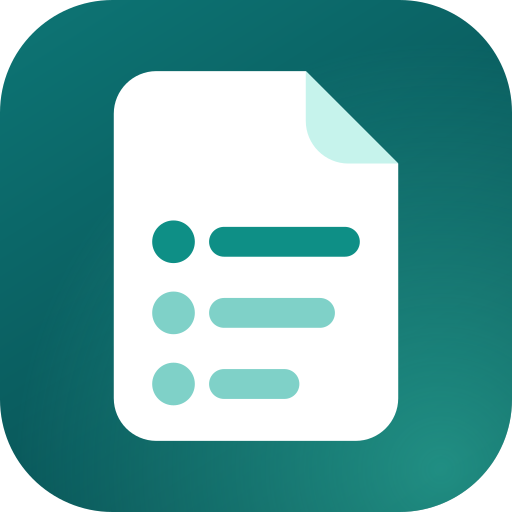

<p align="center">
  
</p>

<h1 align="center">List</h1>

<p align="center">
  <b>An offline file viewer for Android.</b><br>
  Documents, spreadsheets, presentations, PDFs, books, archives, pictures, audio and video open right inside the app.<br>
  No cloud, no account, no ads.
</p>

<p align="center">
  <a href="../../releases/latest/download/List.apk"><b>Download the APK</b></a>
  &nbsp;·&nbsp; Android 7.0 or newer
  &nbsp;·&nbsp; <b>English</b> | <a href="README.ru.md">Русский</a>
</p>

---

## Features

- **One app for most files.** PDF, Word, Excel, PowerPoint, OpenDocument, RTF, EPUB, FB2, HTML, Markdown, JSON, plain text and code, ZIP/RAR/7z/TAR archives, pictures, audio and video.
- **Works offline and keeps files private.** Everything is rendered on the device and nothing is uploaded.
- **Recent files that are easy to navigate.** Grouped by day, searchable by name, filterable by file type. Removing an entry can be undone, and files that were moved or deleted are marked instead of failing silently.
- **Your own order.** Give a file a clearer name (its extension stays locked) and sort files into folders. Names and folders live inside List, so the files on your phone are never touched.
- **Reading tools.** Search inside documents (not yet inside PDFs), pinch and double-tap zoom, a page counter for PDFs, a *Pages / Reading view* switch for Word files, a *Slides / Text* switch for presentations, sheet tabs for workbooks, and a browsable list of the files inside an archive.
- **Plays well with other apps.** Choose *List* from "Open with" in a file manager or messenger. *Back* returns to the app the file came from. Any file can be shared or opened in another app from the ⋮ menu.
- **Looks at home on your phone.** Light and dark themes follow the system, and the interface is available in English and Russian (it follows the system language).

## Supported formats

| Kind | Extensions | How it is shown |
|---|---|---|
| PDF | `pdf` | Android's built-in `PdfRenderer` |
| Word | `docx` `docm` `dotx` `dotm`, and `doc` `dot` `odt` `rtf` | [docx-preview](https://github.com/VolodymyrBaydalka/docxjs) for page layout and [mammoth](https://github.com/mwilliamson/mammoth.js) for the reading view. Older formats are first converted with the ONLYOFFICE engine (x2t, WebAssembly) |
| Excel | `xlsx` `xlsm` `xlsb` `xls` `ods` `csv` `tsv` | [SheetJS](https://sheetjs.com/) |
| PowerPoint | `pptx` `pptm` `ppsx`, and `ppt` `pps` `odp` | [pptx-preview](https://github.com/501351981/pptx-preview) with List's own fixes (see below), plus a text view |
| Books | `epub` `fb2` | Built-in readers |
| Archives | `zip` `rar` `7z` `tar` `gz` `tgz` `bz2` `xz` | JSZip and 7-Zip (WebAssembly); files inside can be opened |
| Text and code | `txt` `md` `json` `xml` `yaml` `log` `srt` `vtt`, source files | Plain view; Markdown and JSON are formatted |
| Web pages | `html` `htm` `xhtml` | `WebView`. Online resources are blocked unless you allow them |
| Pictures | `jpg` `png` `webp` `bmp` `heic` `heif` `avif` `gif` `svg` | [Coil](https://coil-kt.github.io/coil/) or the web viewer |
| Audio and video | `mp3` `m4a` `aac` `ogg` `opus` `flac` `wav`, `mp4` `m4v` `mkv` `webm` `3gp` `mov` | [Media3 ExoPlayer](https://developer.android.com/media/media3/exoplayer) |

### Known limits

- Password-protected files are not supported; the app shows an error.
- Only the first 3,000 rows of each sheet and the first 2 million characters of a text file are shown.
- Legacy formats go through a converter that is not perfect. If it fails, Word and PowerPoint files fall back to their text.
- Support for HEIC, HEIF and AVIF pictures depends on the Android version.
- Very large files can be slow, because documents are converted on the phone.

## Privacy

List does not collect, store or send anything. The `INTERNET` permission exists for one purpose: an HTML file that refers to online images or styles can load them, but only after you choose **Load content from the internet** in the ⋮ menu of that file. Until then every network request from the page is blocked. Backups of app data are turned off.

## PowerPoint rendering

Slides are drawn by [pptx-preview](https://github.com/501351981/pptx-preview), a compact renderer that skips things it does not know. For a real deck the first slide could lose objects, so List extends the library with a small layer of fixes (`app/src/main/assets/pptx/`):

- the 113 preset shapes of the OOXML standard that the library could not draw (it knows only about 70 of 187): stars, hearts, callouts, flow-chart symbols, braces, ribbons, math signs and so on, plus freeform shapes with arcs and curves;
- objects wrapped in `mc:AlternateContent`, which PowerPoint writes for newer features and the library used to skip;
- fields such as slide numbers and dates, hyperlink colour, picture outlines (circles and rounded photos), rotation and flips;
- layout and master objects exported by Google Slides, WPS and LibreOffice, a drawing order that follows the file, and a chart without a title no longer showing placeholder text;
- one broken object no longer blanks the whole slide.

If a slide still does not look like it does in PowerPoint, the **Text** tab shows its contents. An issue with the file (or a screenshot of the slide) is the best way to get it fixed.

## Building

Requirements: JDK 17 and the Android SDK with platform 34 (Android Studio sets both up).

```bash
./gradlew assembleDebug
# → app/build/outputs/apk/debug/app-debug.apk
```

**Automatic builds and releases.** `.github/workflows/build.yml` builds a debug APK on every push and keeps it for 30 days as a workflow artifact (Actions, open the run, section Artifacts). Every release is a separate entry under *Releases*: push a version tag, and the workflow builds the app and publishes it with `List.apk` attached and generated release notes.

```bash
git tag v2.2.0
git push origin v2.2.0
```

A release can also be started by hand from the Actions tab (*Run workflow*, with the version filled in). A version with a suffix, such as `2.3.0-beta.1`, is published as a pre-release. The *Download the APK* link at the top always leads to the newest regular release.

The APK is signed with the debug key stored in the repository (`app/debug.keystore`), so every build installs over the previous one. It is a development key, not a secret one: if you publish the app anywhere else, sign it with your own key.

The package name `app.fileviewer` is kept on purpose, so new versions update existing installations.

## Project layout

```
app/src/main/
├── java/app/fileviewer/
│   ├── MainActivity.kt    entry point and navigation between the two screens
│   ├── HomeScreen.kt      file list: search, filters, folders, undo
│   ├── ViewerScreen.kt    top bar, actions and the content for each file type
│   ├── Viewers.kt         PDF, pictures, audio/video and the WebView host
│   ├── Organize.kt        dialogs for renaming files and managing folders
│   ├── FileInfo.kt        file types, metadata, share and "open in another app"
│   ├── Recents.kt         storage of the list, chosen names and folders
│   └── Theme.kt, Components.kt
├── assets/
│   ├── viewer.html, viewer.js    the in-app document viewer
│   ├── pptx/                     slide-rendering fixes (shapes.js is generated)
│   └── lib/                      bundled third-party libraries
└── res/
    ├── values/, values-ru/       English and Russian strings
    └── drawable/, mipmap-*/      icons and the launcher logo
tools/                            maintenance scripts for the PowerPoint layer
docs/assets/                      logo
```

**Translations.** Interface strings live in `app/src/main/res/values*/strings.xml`. Texts shown inside documents are in the `T` dictionary at the top of `viewer.js`; the viewer picks its language from the `web_lang` string. To add a language, add a `values-xx/strings.xml` and a matching block in `T`.

**PowerPoint layer.** After replacing `lib/pptx-preview.umd.js` with a newer upstream build, run `python3 tools/patch_pptx_preview.py` (the patch is idempotent). `pptx/shapes.js` is generated by `python3 tools/gen_pptx_shapes.py`, which reads the preset-shape table that ships with LibreOffice.

## License

[AGPL-3.0](LICENSE). The embedded ONLYOFFICE converter requires it, and it means that anyone you give the app to is entitled to its source code. Third-party components and their licenses are listed in [THIRD_PARTY.txt](THIRD_PARTY.txt) and [LICENSES/](LICENSES).
