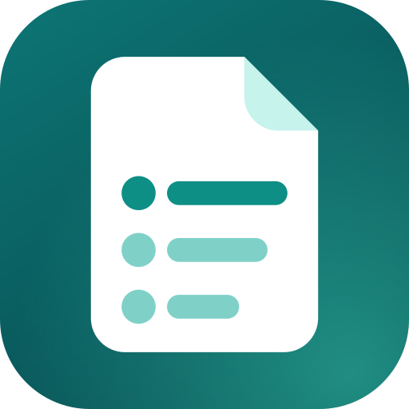

<p align="center">
  
</p>

<h1 align="center">List</h1>

<p align="center">
  <b>Просмотрщик файлов для Android, который работает без интернета.</b><br>
  Документы, таблицы, презентации, PDF, книги, архивы, картинки, аудио и видео открываются прямо в приложении.<br>
  Без облака, без аккаунта, без рекламы.
</p>

<p align="center">
  <a href="../../releases/latest/download/List.apk"><b>Скачать APK</b></a>
  &nbsp;·&nbsp; Android 7.0 и новее
  &nbsp;·&nbsp; <a href="README.md">English</a> | <b>Русский</b>
</p>

---

## Возможности

- **Одно приложение для большинства файлов.** PDF, Word, Excel, PowerPoint, OpenDocument, RTF, EPUB, FB2, HTML, Markdown, JSON, обычный текст и код, архивы ZIP/RAR/7z/TAR, картинки, аудио и видео.
- **Работает без интернета, файлы остаются у вас.** Всё отображается на самом устройстве, ничего никуда не отправляется.
- **Удобный список недавних файлов.** Он разбит по дням, в нём есть поиск по названию, фильтр по типу файла и сортировка по дате, названию, размеру или типу. Нужные файлы можно закрепить вверху. Удаление записи можно отменить, а перемещённые или удалённые файлы помечаются, а не открываются с ошибкой.
- **Продолжайте с того места, где остановились.** List помнит страницу в PDF, место в документе и момент в песне или видео, и при следующем открытии возвращает вас туда.
- **Свой порядок.** Задайте файлу понятное название (расширение остаётся неизменным) и разложите файлы по цветным папкам. Названия и папки хранятся внутри List, поэтому сами файлы на телефоне не затрагиваются. Чтобы файл получил новое название и на самом телефоне, используйте **«Сохранить копию…»**.
- **Сразу несколько файлов.** Удерживайте файл, чтобы выбрать его, и закрепляйте, перемещайте, отправляйте или убирайте всё выбранное за одно действие.
- **Инструменты для чтения.** Поиск по документу и по PDF (в PDF он перечисляет страницы, где есть слова, показывает текст вокруг совпадения и закрашивает слова на странице), масштабирование щипком и двойным касанием, счётчик страниц в PDF, переключатель «Страницы / Для чтения» для Word, «Слайды / Текст» для презентаций, вкладки листов в таблицах и список файлов внутри архива. В параметрах чтения задаётся размер текста, а страницы PDF в тёмной теме можно показывать тёмными.
- **Нормальный экран для аудио.** Музыка и записи открываются на собственном экране, а не на чёрном фоне, как видео: обложка и теги из файла, полоса перемотки, прыжки на 10 секунд и кнопка скорости. Аудиофайлы списка играют один за другим, есть кнопки «предыдущий» и «следующий» трек. Музыка продолжает играть при выключенном экране и поверх других приложений, а управление есть в шторке уведомлений и на экране блокировки (это можно отключить в параметрах экрана аудио). Воспроизведение ставится на паузу при звонке и когда вынимают наушники. У видео остаются привычные кнопки плеера.
- **Следующий и предыдущий файл.** У файла, открытого из списка, в верхней панели есть стрелки и его место в списке («3 / 12»), поэтому папку документов или картинок можно пролистать, не возвращаясь к списку.
- **Удобные отчёты об ошибках.** **«О приложении»** копирует версию, вид сборки, версию Android, устройство и ключ, которым подписано приложение. После сбоя List предлагает скопировать отчёт с описанием ошибки (пути к файлам из него убираются).
- **Список не потеряется.** **«Сохранить копию списка»** записывает названия, папки и места чтения в небольшой файл, **«Восстановить из копии»** возвращает их после переустановки или на новом телефоне. Если Android потерял доступ к файлу, **«Указать файл заново…»** снова направляет запись на него, не теряя названия, папки и места чтения.
- **Дружит с другими приложениями.** Выбирайте *List* в «Открыть с помощью» в файловом менеджере или мессенджере, либо отправляйте файлы сюда через системное меню *«Поделиться»*. Кнопка «Назад» возвращает в приложение, из которого пришёл файл. Любой файл можно отправить или открыть в другом приложении через меню ⋮.
- **Выглядит как родное.** Светлая и тёмная темы следуют системной, интерфейс доступен на английском и русском (язык берётся из настроек системы).

## Поддерживаемые форматы

| Тип | Расширения | Чем открывается |
|---|---|---|
| PDF | `pdf` | Страницы рисует встроенный в Android `PdfRenderer`, текст для поиска читает [PdfBox-Android](https://github.com/TomRoush/PdfBox-Android) |
| Word | `docx` `docm` `dotx` `dotm`, а также `doc` `dot` `odt` `rtf` | [docx-preview](https://github.com/VolodymyrBaydalka/docxjs) для постраничного вида и [mammoth](https://github.com/mwilliamson/mammoth.js) для режима чтения. Старые форматы сначала конвертируются движком ONLYOFFICE (x2t, WebAssembly) |
| Excel | `xlsx` `xlsm` `xlsb` `xls` `ods` `csv` `tsv` | [SheetJS](https://sheetjs.com/) |
| PowerPoint | `pptx` `pptm` `ppsx`, а также `ppt` `pps` `odp` | [pptx-preview](https://github.com/501351981/pptx-preview) с собственными доработками List (см. ниже) и текстовый режим |
| Книги | `epub` `fb2` | Встроенные читалки |
| Архивы | `zip` `rar` `7z` `tar` `gz` `tgz` `bz2` `xz` | JSZip и 7-Zip (WebAssembly); файлы внутри можно открыть |
| Текст и код | `txt` `md` `json` `xml` `yaml` `log` `srt` `vtt`, исходный код | Обычный просмотр; Markdown и JSON оформляются |
| Веб-страницы | `html` `htm` `xhtml` | `WebView`. Ресурсы из интернета блокируются, пока вы их не разрешите |
| Картинки | `jpg` `png` `webp` `bmp` `heic` `heif` `avif` `gif` `svg` | [Coil](https://coil-kt.github.io/coil/) или веб-просмотрщик |
| Аудио и видео | `mp3` `m4a` `aac` `ogg` `opus` `flac` `wav`, `mp4` `m4v` `mkv` `webm` `3gp` `mov` | [Media3 ExoPlayer](https://developer.android.com/media/media3/exoplayer); у аудио свой экран и фоновое воспроизведение |

### Ограничения

- Файлы, защищённые паролем, не поддерживаются, приложение показывает ошибку.
- В таблицах показываются первые 3000 строк каждого листа, в текстовых файлах — первые 2 миллиона символов.
- Старые форматы проходят через конвертер, который не идеален. Если он не справился, Word и PowerPoint показываются как текст.
- Поддержка картинок HEIC, HEIF и AVIF зависит от версии Android.
- Очень большие файлы могут открываться медленно, потому что документы конвертируются прямо на телефоне.
- Файл, присланный в List из другого приложения, обычно получает от Android только временный доступ. Он открывается сразу, но после перезапуска приложения в списке может быть отмечен как «не найден». Нажмите на него и выберите **«Указать файл заново…»**, либо открывайте такие файлы кнопкой **«Открыть файл»**: она сохраняет доступ.
- Поиск в PDF перечисляет страницы, где есть слова, показывает текст вокруг первого совпадения и закрашивает слова на страницах (совпадение, на котором стоит строка поиска, — оранжевым, остальные — жёлтым). Места слов читаются из файла, когда страница появляется на экране, поэтому закраска может появиться чуть позже страницы; повёрнутый текст и текст, идущий сверху вниз, не закрашивается. В PDF из отсканированных картинок текста для поиска нет.
- Аудио продолжает играть в фоне только пока открыт его экран: кнопка «Назад» или смахивание приложения из списка недавних его останавливает. Название трека — это название файла (или имя, которое вы дали ему в List); исполнитель, альбом и обложка берутся из тегов. Видео играет внутри приложения. На некоторых телефонах система останавливает фоновые приложения ради экономии заряда, и музыка тоже может остановиться; обычное средство — разрешить List работать без ограничений батареи.
- Резервная копия содержит названия и адреса файлов, а не сами файлы. После восстановления на новом телефоне записи показываются как «не найден», пока вы не укажете файлы через **«Указать файл заново…»**.

## Конфиденциальность

List ничего не собирает, не хранит и не отправляет. Названия, папки, закреплённые файлы и места чтения остаются на устройстве; файл резервной копии создаётся только по вашей просьбе и попадает туда, куда вы его сохраните. Разрешение `INTERNET` нужно ровно для одного: HTML-файл, который ссылается на картинки или стили в сети, может их загрузить, но только после того, как вы выберете в меню ⋮ этого файла пункт **Загружать содержимое из интернета**. Пока вы этого не сделали, все сетевые запросы страницы блокируются. Разрешение `WAKE_LOCK` нужно только затем, чтобы процессор не засыпал, пока играет запись при погашенном экране. Разрешения `FOREGROUND_SERVICE` и `POST_NOTIFICATIONS` нужны только для уведомления проигрывателя; начиная с Android 13 List один раз спрашивает разрешение его показывать, а музыка от ответа не зависит. Резервное копирование данных приложения отключено.

## Как отображаются презентации PowerPoint

Слайды рисует [pptx-preview](https://github.com/501351981/pptx-preview) — компактная библиотека, которая пропускает всё, чего не знает. На настоящей презентации первый же слайд мог терять часть объектов, поэтому в List добавлен небольшой слой исправлений (`app/src/main/assets/pptx/`):

- 113 стандартных фигур OOXML, которых библиотека не умела рисовать (она знает лишь около 70 из 187): звёзды, сердца, выноски, символы блок-схем, скобки, ленты, математические знаки и другие, а также произвольные фигуры с дугами и кривыми;
- объекты внутри `mc:AlternateContent`, которые PowerPoint записывает для новых возможностей и которые библиотека раньше пропускала;
- поля (номер слайда, дата и подобные), цвет гиперссылок, контуры картинок (круглые и скруглённые фото), повороты и отражения;
- объекты макетов и образцов, сохранённые Google Slides, WPS и LibreOffice, порядок отрисовки как в файле, диаграмма без заголовка больше не показывает служебный текст;
- один сломанный объект больше не делает пустым весь слайд.

Если слайд всё же выглядит не так, как в PowerPoint, его содержимое можно прочитать на вкладке **Текст**. Лучший способ добиться исправления — прислать файл (или скриншот слайда) в issue.

## Сборка

Нужны JDK 17 и Android SDK с платформой 34 (Android Studio настроит оба).

```bash
./gradlew assembleRelease
# → app/build/outputs/apk/release/app-release.apk  (оптимизирован R8, подписан общедоступным ключом из репозитория или вашим, см. «Ключ подписи»)

./gradlew assembleDebug
# → app/build/outputs/apk/debug/app-debug.apk      (для разработки; Android запускает его заметно медленнее)

./gradlew testDebugUnitTest
# юнит-тесты списка, резервных копий, сортировки, названий, поиска и закраски в PDF, очереди и расчётов аудио, переходов между файлами, отчётов о сбоях и подписей (app/src/test)

./gradlew lintDebug
# отчёт Android Lint: app/build/reports/lint-results-debug.html
```

**Автоматическая сборка и релизы.** `.github/workflows/build.yml` собирает оптимизированный (release) APK при каждом `git push` и хранит его 30 дней как артефакт запуска (вкладка Actions, нужный запуск, раздел Artifacts). Каждый релиз — отдельная запись в разделе *Releases*: отправьте тег версии, и workflow соберёт приложение и опубликует его с файлом `List.apk`. Описание релиза — это раздел нужной версии из [CHANGELOG.md](CHANGELOG.md), а под ним автоматически составленный список изменений.

```bash
git tag v2.5.0
git push origin v2.5.0
```

Релиз можно запустить и вручную на вкладке Actions (*Run workflow*, указав версию). Версия с суффиксом, например `2.5.0-beta.1`, публикуется как предварительная. Отдельное задание запускает юнит-тесты рядом с каждой сборкой, а ещё одно — Android Lint; упавший тест или замечание lint видны как предупреждение и никогда не блокируют релиз. Если оптимизатор вдруг не справится, workflow соберёт обычный debug-APK и скажет об этом в предупреждении (в окне «О приложении» такой сборки будет строка «Отладочная сборка»). Dependabot раз в месяц предлагает обновления библиотек и GitHub Actions. Ссылка *Скачать APK* вверху всегда ведёт на самый новый обычный релиз.

### Ключ подписи

По умолчанию APK подписан общедоступным ключом из репозитория (`app/debug.keystore`), поэтому каждая новая сборка ставится поверх предыдущей. Этот ключ не секретный: обновление, которое приложение примет, мог бы сделать кто угодно. Строка *Подпись* в окне **«О приложении»** показывает, каким ключом подписано установленное приложение.

Ключ, который есть только у вас, — по желанию:

1. В PowerShell на Windows запустите `tools\New-ReleaseKey.ps1`. Скрипт создаёт ключ и случайный пароль вне репозитория (нужен `keytool` из JDK; если его нет, скрипт подскажет, как поставить) и по шагам помогает добавить два секрета репозитория (*Settings → Secrets and variables → Actions*): `KEYSTORE_BASE64` и `KEYSTORE_PASSWORD`. Без Windows: `keytool -genkeypair -keystore list-release.p12 -storetype PKCS12 -alias list -keyalg RSA -keysize 3072 -validity 36500`, затем `base64 -w0 list-release.p12` и пароль кладутся в эти секреты. Ещё два секрета необязательны: `KEY_ALIAS` (по умолчанию `list`) и `KEY_PASSWORD` (по умолчанию — пароль хранилища).
2. Собирайте как обычно (push или тег). На странице запуска будет написано, подписан ли APK вашим ключом, и показан отпечаток SHA-256 его сертификата; тот же отпечаток виден в **«О приложении»**. Если ключ не открывается или APK подписан другим ключом, запуск остановится с понятным сообщением, а не опубликует APK, который не установится.
3. **Берегите ключ и пароль** (менеджер паролей, личное облако). Если их потерять, приложения с этой подписью больше нельзя будет обновить; репозиторию они не нужны, а `.gitignore` не пускает файлы ключей в git.

У перехода есть разовая цена. Android не ставит приложение поверх приложения с другой подписью, поэтому первая сборка с новым ключом требует переустановки: в старой версии выберите **«Сохранить копию списка»**, удалите List, поставьте новый APK и выберите **«Восстановить из копии»**. Названия, папки и места чтения вернутся, но при удалении приложения Android отбирает у List доступ к файлам, поэтому каждая запись будет показана как «не найдено», пока вы не укажете файл через **«Указать файл заново…»**. Переходить стоит один раз, только если вам нужна эта защита, и лучше пока список короткий. Сборки без секретов (форки, Dependabot) подписываются общедоступным ключом, как раньше.

Имя пакета `app.fileviewer` оставлено намеренно, чтобы новые версии обновляли уже установленные.

## Устройство проекта

```
app/src/main/
├── java/app/fileviewer/
│   ├── MainActivity.kt    точка входа, переход между двумя экранами, файлы, присланные в приложение
│   ├── HomeScreen.kt      список файлов: поиск, фильтры, сортировка, выбор, папки, резервная копия, отмена
│   ├── HomeParts.kt       части этого экрана: строки, карточки папок, панель выбора
│   ├── ViewerScreen.kt    верхняя панель, действия и содержимое для каждого типа
│   ├── Viewers.kt         PDF, картинки и обёртка над WebView (с местом чтения)
│   ├── Media.kt           аудио и видео: плеер и экран аудио
│   ├── Playback.kt, PlaybackService.kt   очередь аудио и служба, которая играет её при погашенном экране
│   ├── ListApp.kt, CrashLog.kt, AppInfo.kt   отчёты о сбоях и то, что «О приложении» знает об установке
│   ├── PdfSearch.kt       поиск по PDF: чтение текста страниц, строка поиска
│   ├── MediaMath.kt, SearchLogic.kt, PdfMarks.kt, Playlist.kt, Navigation.kt, AboutText.kt, CrashReport.kt, Signature.kt   чистые расчёты для этих экранов (покрыты юнит-тестами)
│   ├── Organize.kt        диалоги переименования файлов и работы с папками
│   ├── Options.kt         параметры чтения и «Сохранить копию…»
│   ├── FileInfo.kt        типы файлов, метаданные, «поделиться» и «открыть в другом приложении»
│   ├── Recents.kt         хранение списка: названия, папки, закрепление, места чтения
│   ├── Backup.kt          файл резервной копии (JSON) и его безопасное чтение
│   ├── Sorting.kt, Names.kt, Settings.kt
│   └── Theme.kt, Components.kt
├── assets/
│   ├── viewer.html, viewer.js    встроенный просмотрщик документов
│   ├── pptx/                     исправления отрисовки слайдов (shapes.js генерируется)
│   └── lib/                      встроенные сторонние библиотеки
└── res/
    ├── values/, values-ru/       строки на английском и русском
    └── drawable/, mipmap-*/      значки и логотип приложения
app/src/test/                     юнит-тесты (список, резервные копии, сортировка, названия, поиск по PDF, очередь аудио, переходы, отчёты о сбоях)
tools/                            служебные скрипты (слой PowerPoint; Update-List.ps1 применяет архив проекта в Windows)
docs/assets/                      логотип
```

**Переводы.** Строки интерфейса лежат в `app/src/main/res/values*/strings.xml`. Тексты внутри документов — в словаре `T` в начале `viewer.js`; язык просмотрщик берёт из строки `web_lang`. Чтобы добавить язык, создайте `values-xx/strings.xml` и соответствующий блок в `T`.

**Слой PowerPoint.** После замены `lib/pptx-preview.umd.js` более новой сборкой запустите `python3 tools/patch_pptx_preview.py` (патч можно применять повторно). Файл `pptx/shapes.js` создаётся командой `python3 tools/gen_pptx_shapes.py`, которая читает таблицу фигур из установленного LibreOffice.

## Лицензия

[AGPL-3.0](LICENSE). Её требует встроенный конвертер ONLYOFFICE; это значит, что любой, кому вы передаёте приложение, вправе получить его исходный код. Сторонние компоненты и их лицензии перечислены в [THIRD_PARTY.txt](THIRD_PARTY.txt) и в папке [LICENSES/](LICENSES).
