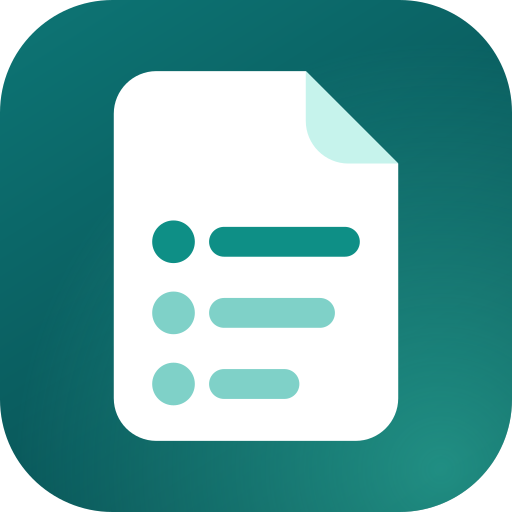

<p align="center">
  
</p>

<h1 align="center">List</h1>

<p align="center">
  <b>Просмотрщик файлов для Android, который работает без интернета.</b><br>
  Документы, таблицы, презентации, PDF, книги, архивы, картинки, аудио и видео открываются прямо в приложении.<br>
  Без облака, без аккаунта, без рекламы.
</p>

<p align="center">
  <a href="../../releases/latest/download/List.apk"><b>Скачать APK</b></a>
  &nbsp;·&nbsp; Android 7.0 и новее
  &nbsp;·&nbsp; <a href="README.md">English</a> | <b>Русский</b>
</p>

---

## Возможности

- **Одно приложение для большинства файлов.** PDF, Word, Excel, PowerPoint, OpenDocument, RTF, EPUB, FB2, HTML, Markdown, JSON, обычный текст и код, архивы ZIP/RAR/7z/TAR, картинки, аудио и видео.
- **Работает без интернета, файлы остаются у вас.** Всё отображается на самом устройстве, ничего никуда не отправляется.
- **Удобный список недавних файлов.** Он разбит по дням, в нём есть поиск по названию и фильтр по типу файла. Удаление записи можно отменить, а перемещённые или удалённые файлы помечаются, а не открываются с ошибкой.
- **Свой порядок.** Задайте файлу понятное название (расширение остаётся неизменным) и разложите файлы по папкам. Названия и папки хранятся внутри List, поэтому сами файлы на телефоне не затрагиваются.
- **Инструменты для чтения.** Поиск по документу (в PDF пока нет), масштабирование щипком и двойным касанием, счётчик страниц в PDF, переключатель «Страницы / Для чтения» для Word, «Слайды / Текст» для презентаций, вкладки листов в таблицах и список файлов внутри архива.
- **Дружит с другими приложениями.** Выбирайте *List* в «Открыть с помощью» в файловом менеджере или мессенджере. Кнопка «Назад» возвращает в приложение, из которого пришёл файл. Любой файл можно отправить или открыть в другом приложении через меню ⋮.
- **Выглядит как родное.** Светлая и тёмная темы следуют системной, интерфейс доступен на английском и русском (язык берётся из настроек системы).

## Поддерживаемые форматы

| Тип | Расширения | Чем открывается |
|---|---|---|
| PDF | `pdf` | Встроенный в Android `PdfRenderer` |
| Word | `docx` `docm` `dotx` `dotm`, а также `doc` `dot` `odt` `rtf` | [docx-preview](https://github.com/VolodymyrBaydalka/docxjs) для постраничного вида и [mammoth](https://github.com/mwilliamson/mammoth.js) для режима чтения. Старые форматы сначала конвертируются движком ONLYOFFICE (x2t, WebAssembly) |
| Excel | `xlsx` `xlsm` `xlsb` `xls` `ods` `csv` `tsv` | [SheetJS](https://sheetjs.com/) |
| PowerPoint | `pptx` `pptm` `ppsx`, а также `ppt` `pps` `odp` | [pptx-preview](https://github.com/501351981/pptx-preview) с собственными доработками List (см. ниже) и текстовый режим |
| Книги | `epub` `fb2` | Встроенные читалки |
| Архивы | `zip` `rar` `7z` `tar` `gz` `tgz` `bz2` `xz` | JSZip и 7-Zip (WebAssembly); файлы внутри можно открыть |
| Текст и код | `txt` `md` `json` `xml` `yaml` `log` `srt` `vtt`, исходный код | Обычный просмотр; Markdown и JSON оформляются |
| Веб-страницы | `html` `htm` `xhtml` | `WebView`. Ресурсы из интернета блокируются, пока вы их не разрешите |
| Картинки | `jpg` `png` `webp` `bmp` `heic` `heif` `avif` `gif` `svg` | [Coil](https://coil-kt.github.io/coil/) или веб-просмотрщик |
| Аудио и видео | `mp3` `m4a` `aac` `ogg` `opus` `flac` `wav`, `mp4` `m4v` `mkv` `webm` `3gp` `mov` | [Media3 ExoPlayer](https://developer.android.com/media/media3/exoplayer) |

### Ограничения

- Файлы, защищённые паролем, не поддерживаются, приложение показывает ошибку.
- В таблицах показываются первые 3000 строк каждого листа, в текстовых файлах — первые 2 миллиона символов.
- Старые форматы проходят через конвертер, который не идеален. Если он не справился, Word и PowerPoint показываются как текст.
- Поддержка картинок HEIC, HEIF и AVIF зависит от версии Android.
- Очень большие файлы могут открываться медленно, потому что документы конвертируются прямо на телефоне.

## Конфиденциальность

List ничего не собирает, не хранит и не отправляет. Разрешение `INTERNET` нужно ровно для одного: HTML-файл, который ссылается на картинки или стили в сети, может их загрузить, но только после того, как вы выберете в меню ⋮ этого файла пункт **Загружать содержимое из интернета**. Пока вы этого не сделали, все сетевые запросы страницы блокируются. Резервное копирование данных приложения отключено.

## Как отображаются презентации PowerPoint

Слайды рисует [pptx-preview](https://github.com/501351981/pptx-preview) — компактная библиотека, которая пропускает всё, чего не знает. На настоящей презентации первый же слайд мог терять часть объектов, поэтому в List добавлен небольшой слой исправлений (`app/src/main/assets/pptx/`):

- 113 стандартных фигур OOXML, которых библиотека не умела рисовать (она знает лишь около 70 из 187): звёзды, сердца, выноски, символы блок-схем, скобки, ленты, математические знаки и другие, а также произвольные фигуры с дугами и кривыми;
- объекты внутри `mc:AlternateContent`, которые PowerPoint записывает для новых возможностей и которые библиотека раньше пропускала;
- поля (номер слайда, дата и подобные), цвет гиперссылок, контуры картинок (круглые и скруглённые фото), повороты и отражения;
- объекты макетов и образцов, сохранённые Google Slides, WPS и LibreOffice, порядок отрисовки как в файле, диаграмма без заголовка больше не показывает служебный текст;
- один сломанный объект больше не делает пустым весь слайд.

Если слайд всё же выглядит не так, как в PowerPoint, его содержимое можно прочитать на вкладке **Текст**. Лучший способ добиться исправления — прислать файл (или скриншот слайда) в issue.

## Сборка

Нужны JDK 17 и Android SDK с платформой 34 (Android Studio настроит оба).

```bash
./gradlew assembleDebug
# → app/build/outputs/apk/debug/app-debug.apk
```

**Автоматическая сборка и релизы.** `.github/workflows/build.yml` собирает debug-APK при каждом `git push` и хранит его 30 дней как артефакт запуска (вкладка Actions, нужный запуск, раздел Artifacts). Каждый релиз — отдельная запись в разделе *Releases*: отправьте тег версии, и workflow соберёт приложение и опубликует его с файлом `List.apk` и автоматически составленным списком изменений.

```bash
git tag v2.2.0
git push origin v2.2.0
```

Релиз можно запустить и вручную на вкладке Actions (*Run workflow*, указав версию). Версия с суффиксом, например `2.3.0-beta.1`, публикуется как предварительная. Ссылка *Скачать APK* вверху всегда ведёт на самый новый обычный релиз.

APK подписан debug-ключом из репозитория (`app/debug.keystore`), поэтому каждая новая сборка ставится поверх предыдущей. Это ключ для разработки, а не секретный: если будете публиковать приложение где-то ещё, подпишите его собственным ключом.

Имя пакета `app.fileviewer` оставлено намеренно, чтобы новые версии обновляли уже установленные.

## Устройство проекта

```
app/src/main/
├── java/app/fileviewer/
│   ├── MainActivity.kt    точка входа и переход между двумя экранами
│   ├── HomeScreen.kt      список файлов: поиск, фильтры, папки, отмена удаления
│   ├── ViewerScreen.kt    верхняя панель, действия и содержимое для каждого типа
│   ├── Viewers.kt         PDF, картинки, аудио/видео и обёртка над WebView
│   ├── Organize.kt        диалоги переименования файлов и работы с папками
│   ├── FileInfo.kt        типы файлов, метаданные, «поделиться» и «открыть в другом приложении»
│   ├── Recents.kt         хранение списка, выбранных названий и папок
│   └── Theme.kt, Components.kt
├── assets/
│   ├── viewer.html, viewer.js    встроенный просмотрщик документов
│   ├── pptx/                     исправления отрисовки слайдов (shapes.js генерируется)
│   └── lib/                      встроенные сторонние библиотеки
└── res/
    ├── values/, values-ru/       строки на английском и русском
    └── drawable/, mipmap-*/      значки и логотип приложения
tools/                            скрипты для слоя PowerPoint
docs/assets/                      логотип
```

**Переводы.** Строки интерфейса лежат в `app/src/main/res/values*/strings.xml`. Тексты внутри документов — в словаре `T` в начале `viewer.js`; язык просмотрщик берёт из строки `web_lang`. Чтобы добавить язык, создайте `values-xx/strings.xml` и соответствующий блок в `T`.

**Слой PowerPoint.** После замены `lib/pptx-preview.umd.js` более новой сборкой запустите `python3 tools/patch_pptx_preview.py` (патч можно применять повторно). Файл `pptx/shapes.js` создаётся командой `python3 tools/gen_pptx_shapes.py`, которая читает таблицу фигур из установленного LibreOffice.

## Лицензия

[AGPL-3.0](LICENSE). Её требует встроенный конвертер ONLYOFFICE; это значит, что любой, кому вы передаёте приложение, вправе получить его исходный код. Сторонние компоненты и их лицензии перечислены в [THIRD_PARTY.txt](THIRD_PARTY.txt) и в папке [LICENSES/](LICENSES).
